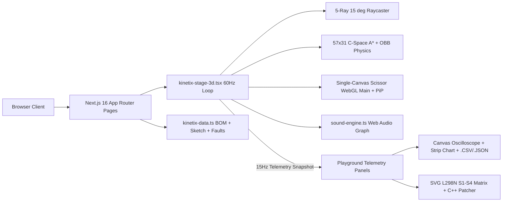
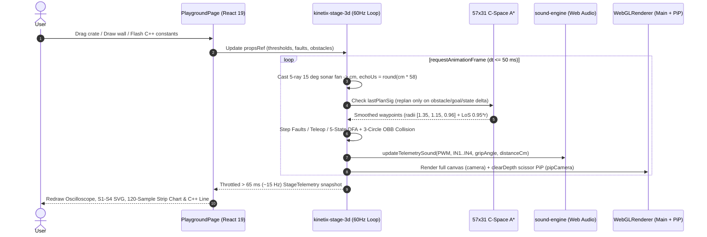
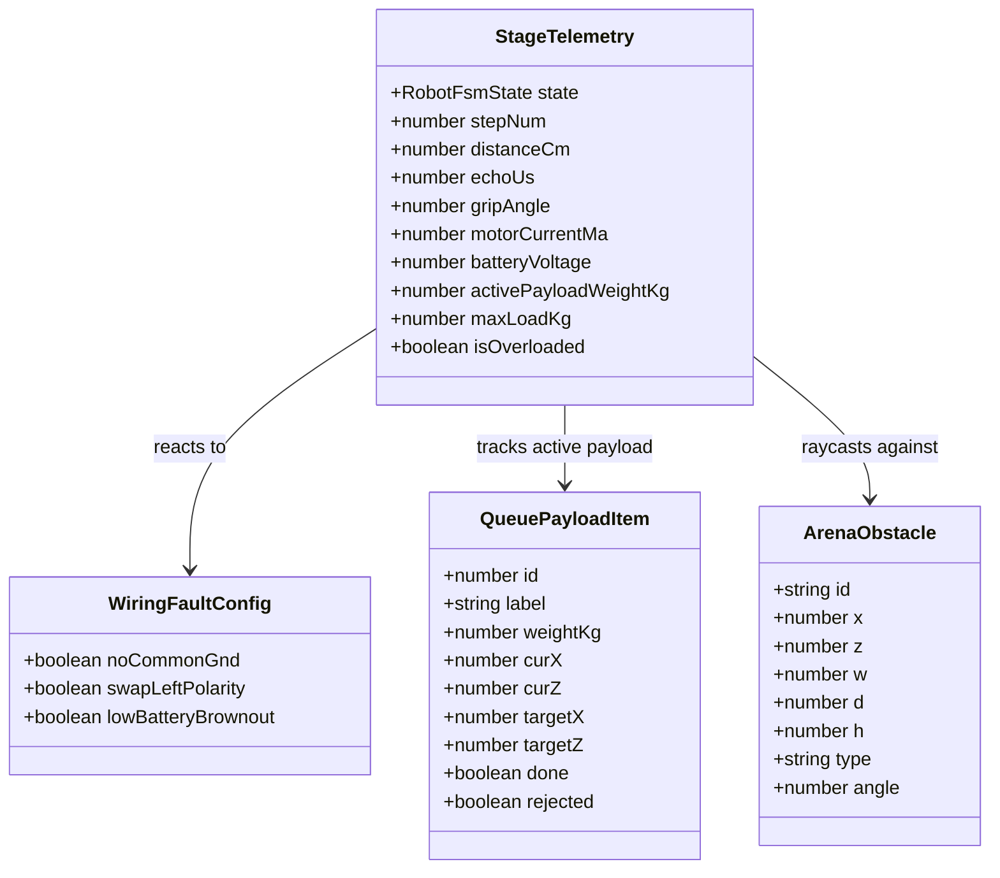

# KinetiX — Architecture

---

## 1. Stack & Runtime Versions

| Layer | Technology & Exact Version | Runtime / Region / Notes |
|---|---|---|
| Framework | Next.js `16.4.5` (App Router, Turbopack) · TypeScript `7.0.2` | Node `22.x` · `pnpm` (`lockfileVersion 9.0`) · Vercel Static/Edge |
| UI & Styling | React `19.3.1` · Tailwind CSS `4.3.4` (`@tailwindcss/postcss`) | Industrial Brutalist CSS var tokens (`src/app/globals.css`) |
| 3D Graphics | Three.js `0.187.0` (`r187`) | `WebGLRenderer`, Scissor Dual-Viewport, `Raycaster`, `PCFShadowMap` (`2048×2048`) |
| Audio & Telemetry | Browser Web Audio API · HTML5 2D Canvas | `DynamicsCompressorNode` + 3-layer synth · Oscilloscope & 120-sample strip chart |
| Embedded Firmware | Arduino C/C++ (`Servo.h`, `pulseIn`, Hardware PWM) | ATmega328P (`16 MHz`, `5 V` logic, `9600` baud, `25 Hz` loop) |
| Hosting & Security | Vercel (`kinetix`) · GitHub Actions | `vercel.json` HTTP security headers · CI, CodeQL, Gitleaks, Dependency Review, Renovate |

---

## 2. System Topology & Components



```text
src/
  app/
    page.tsx                 [01] Specification landing page, 5-state DFA, 12 steps & benchmark matrix (496 lines)
    playground/page.tsx      [02] 3D twin host, oscilloscope, H-Bridge SVG, C++ patcher & strip chart (1,508 lines)
    hardware/page.tsx        [03] 6-subsystem BOM datasheets, 4-fault interactive schematic & .ino export (530 lines)
    how-it-works/page.tsx    [04] 5 governing mechatronic laws, truth tables & v2 upgrade roadmap (298 lines)
    opengraph-image.tsx      Dynamic 1200x630 OpenGraph / Twitter social card (158 lines)
    apple-icon.tsx           180x180 PNG touch icon (33 lines)
    icon.svg                 Scalable HC-SR04 + gripper vector favicon (12 lines)
    sitemap.ts / robots.ts / manifest.ts  SEO & PWA metadata routes
  components/
    kinetix-stage-3d.tsx     Three.js 60 Hz kinematics, 57x31 C-Space A*, OBB collisions & PiP (2,831 lines)
    navbar.tsx               Sticky navigation bar + 4-tab mobile navigation strip (130 lines)
    footer.tsx               System metadata and route links footer (71 lines)
  lib/
    kinetix-data.ts          Single source of truth for FSM, 12 steps, 6 BOM specs, scenarios & .ino sketch (650 lines)
    sound-engine.ts          Compressor-boosted multi-channel Web Audio synth (519 lines)
```

### `kinetix-stage-3d.tsx` (3D Physics, C-Space A\* Pathfinder & Dual-Viewport Engine)
Loaded exclusively on the client via `next/dynamic(..., { ssr: false })`. Maintains one persistent `THREE.Scene`, `camera`, `pipCamera`, and `THREE.WebGLRenderer`, storing fast-changing simulation physics inside mutable `physRef` (`useRef`) while reading reactive UI settings from `propsRef`. Does not perform network calls or React renders inside the 60 Hz animation loop.

### `playground/page.tsx` (Telemetry, C++ Patcher & Blackbox Recorder)
Synchronizes the 5-stage DFA pipeline bar, C++ constant patcher (`PICK_DIST_CM`, `AVOID_DIST_CM`, `GRIP_CLOSED_DEG`, `SPIN_DELAY_MS`, `MAX_LOAD_KG`, `CRUISE_PWM`), dual-trace HC-SR04 Canvas oscilloscope, SVG H-Bridge matrix ($S_1\text{–}S_4$), and 120-sample rolling Blackbox Strip Chart with `.CSV`/`.JSON` download.

### `kinetix-data.ts` & `sound-engine.ts` (Domain Specs & Mechatronic Audio)
`kinetix-data.ts` exports typed specifications (`FSM_STAGES`, `TWELVE_STEPS`, `HARDWARE_MODULES`, `PRESET_SCENARIOS`, `STATE_MACHINE_CODE`, `FULL_ARDUINO_SKETCH`, `DESIGN_RATIONALE_QA`). `sound-engine.ts` synthesizes continuous motor/gearbox/PWM harmonics alongside discrete event sounds (`playServoActuation`, `playBrakeScreech`, `playOverloadReject`, `playStateChime`, adaptive sonar pings).

---

## 3. End-to-End Execution & Telemetry Flow



---

## 4. Client State & Telemetry Data Model

KinetiX uses **zero SQL/NoSQL persistence** — all domain entities live in ephemeral React state and `useRef` buffers during a browser session.



| Type / Structure | Key Fields | Location | Purpose |
|---|---|---|---|
| `StageTelemetry` | `x, z, headingDeg, state, stepNum, distanceCm, echoUs, in1..in4, leftPwm, rightPwm, motorCurrentMa, batteryVoltage, activePayloadWeightKg, maxLoadKg, isOverloaded` | `src/components/kinetix-stage-3d.tsx` | 15 Hz telemetry payload pushed to UI & blackbox ring |
| `ArenaObstacle` | `id, x, z, w, d, h, type ("crate" \| "angled" \| "foam"), label, angle` | `src/lib/kinetix-data.ts` | Dynamic crates, 45° deflectors, foam blocks, and user-drawn maze walls |
| `QueuePayloadItem` | `id, label, color, weightKg, startX/Z, curX/Z, targetX/Z, done, rejected` | `src/components/kinetix-stage-3d.tsx` | Multi-object queue for `20KG vs 10KG DEMO` (`2` items) and `3-OBJECT SORT` (`3` items) |
| `TelemetrySample` | `ts, state, step, distanceCm, echoUs, gripAngle, leftPwm, motorCurrentMa, batteryVoltage` | `src/app/playground/page.tsx` | `120`-entry ring buffer feeding Strip Chart + `.CSV`/`.JSON` download |

---

## 5. Caching, State Synchronization & Concurrency Control

- **60 Hz vs. 15 Hz Loop Decoupling:** `physRef` mutates at display refresh rate (`dt <= 0.05s`) without React reconciliation. React state (`setTelemetry`, `setWorldTags`, `setXrayTags`, `setYoloBoxes`) updates strictly when `now - lastUi > 65 ms` (~15 Hz).
- **Signature-Gated A\* Replanning:** `navigateAStarToGoal` caches `lastPlanSig = "${state}:${goal}:${obstacles}"`. A\* runs **only** when obstacles, goal, or state change or after a `REVERSE_CLEAR` recovery — preventing `pathIdx` thrashing mid-turn.
- **Audio Context Lifecycle:** Browser autoplay policies suspend `AudioContext` until user interaction; `playground/page.tsx` registers one-time `pointerdown`/`keydown` listeners (`{ once: true }`) to unlock `soundEngine`, and `kinetix-stage-3d.tsx` invokes `soundEngine.silenceMotor()` inside its cleanup function on unmount.

---

## 6b. WebGL Digital Twin, C-Space A\* & Firmware Telemetry Pipeline

### Ultrasonic Acoustic Raycaster (`computeSonar`)
- Emits `5` rays across `±7.5°` (`15°` total cone) from `frontOffset` (`+1.66` world units carrying payload, `+1.02` unloaded), with `WORLD_TO_CM = 15.0`, `near = 0.05`, `far = 10.0`.
- When both `yoloEnabled` and `slamEnabled` are `false`, `"foam"` obstacles attenuate range by `1.85×` and `"angled"` walls deflect echo by `1.45×`; enabling `YOLO HUD` or `360° SLAM` restores exact geometric range.
- Computes round-trip microseconds via `echoUs = Math.round(cm * 58)` clamped to `2.0–120.0 cm`.

### `57 × 31` C-Space A\* Pathfinder & 3-Circle OBB Collision
- Discretizes `X ∈ [-7.25, 6.75]`, `Z ∈ [-3.75, 3.75]` at `GRID_CELL = 0.25` (`57 × 31 = 1,767` cells).
- Attempts A\* across adaptive C-Space inflation radii `[1.35, 1.15, 0.96]`, applying a soft proximity cost halo (`+4.5` normalized within `radius + 0.75`), wall margin penalty (`|z| > 2.85`), outward-only escape constraint (`obsDist > curObsDist + 0.01`), and line-of-sight string-pulling at `0.95 × radius`.
- Enforces 3-circle OBB capsule collision against obstacles (`offsets [-0.42, +0.15, +0.72]`, `radii [0.74, 0.78, 0.72]`) and 3 floor-cylinder disks (`offsets [-0.42, +0.10, +0.55]`, `minDist [0.92, 0.95, 0.85]`).

### Multi-Channel Web Audio Synthesizer (`sound-engine.ts`)
- Master `DynamicsCompressorNode` (`threshold -18 dB`, `knee 10`, `ratio 4:1`, `attack 3 ms`, `release 150 ms`) + `1.45×` makeup gain driving:
  - **Continuous Drive:** Sawtooth armature (`145–280 Hz`), `2×` square spur gearbox mesh, `4×` triangle PWM carrier, `18–40 Hz` LFO, and `1250–2100 Hz` lowpass filter.
  - **Events:** `1120 Hz` square reverse beeper (`330 ms` interval), `420 → 95 Hz` active brake screech, `340 ms` FM SG90 servo whir + clamp thud, `195 → 115 Hz` stall groan + 3-tone overload alarm (`740 / 523.25 / 370 Hz`), and `165–640 ms` adaptive sonar pings.

### Embedded ATmega328P C/C++ Firmware (`FULL_ARDUINO_SKETCH`)
- **Pin Map:** `D10` (`TRIG_PIN`), `D11` (`ECHO_PIN`), `D5` (`ENA_PIN`), `D7`/`D8` (`IN1`/`IN2`), `D6` (`ENB_PIN`), `D4`/`D2` (`IN3`/`IN4`), `D9` (`SERVO_PIN`, `50 Hz`).
- **Loop Timing:** `40 ms` delay (`25 Hz` loop cadence), `30,000 µs` (`30 ms`) `pulseIn` timeout (`400.0 cm` clear fallback), `CRUISE_PWM = 170`, `CREEP_PWM = 115`, `SPIN_PWM = 190`, `TARGET_REACH_MS = 8000`.

---

## 7. Application Routes & Static Endpoints

KinetiX has **zero `/api/*` server routes**; all routes below are statically generated (`next build`) or edge-cached image/metadata endpoints:

| Method | Route | Rendering | Purpose |
|---|---|---|---|
| `GET` | `/` | Static Prerender | Specification overview, 5-state DFA, 12-step matrix, BOM summary, benchmark table |
| `GET` | `/playground` | Static Prerender + Client WebGL (`ssr: false`) | 3D Digital Twin stage, C++ patcher, oscilloscope, H-bridge SVG & blackbox |
| `GET` | `/hardware` | Static Prerender | 6-subsystem interactive datasheets, 4-fault Common Ground lab & `.ino` download |
| `GET` | `/how-it-works` | Static Prerender | 5 governing equations, L298N + differential drive truth tables & v2 roadmap |
| `GET` | `/opengraph-image`, `/twitter-image`, `/apple-icon`, `/icon.svg` | Build-time Image/Static | `1200×630` social preview, `180×180` Apple icon, vector favicon |
| `GET` | `/sitemap.xml`, `/robots.txt`, `/manifest.webmanifest` | Metadata Route | Crawler indexing & PWA manifest |

---

## 8. Security Controls

- **Zero Server Attack Surface:** No backend database, session cookies, or user-submitted server payloads exist; `.CSV`/`.JSON` and `.INO` exports are synthesized purely in client memory via `Blob` URLs.
- **Secrets & Environment Hygiene:** `.env*` files are gitignored (`.env`, `.env.local`, `.env.*.local`); `.env.example` documents `NEXT_PUBLIC_SITE_URL=` with an empty value.
- **HTTP Response Headers (`vercel.json`):** Enforces `X-Content-Type-Options: nosniff`, `X-Frame-Options: DENY`, `Referrer-Policy: strict-origin-when-cross-origin`, `Permissions-Policy: camera=(), microphone=(), geolocation=()`, and `Strict-Transport-Security: max-age=63072000; includeSubDomains; preload` on `/(.*)`.
- **Supply-Chain & SAST Automation:** `.github/workflows/` enforces `ci.yml`, `codeql.yml` (`security-extended,security-and-quality`), `dependency-review.yml` (blocks high/critical CVEs), `secret-scan.yml` (Gitleaks), and weekly `renovate.yml` updates.

---

## 9. Error Handling, Reliability & Observability

| Failure Mode | System Behavior | User Feedback |
|---|---|---|
| Overweight payload (`weightKg > maxLoadKg`) | `985 mA` stall current spike, `0.90s` strain shudder, `90°` release, `0.65s` reverse, reroute | Red `[OVERWEIGHT!]` badge + status readout |
| Obstacle contact / dynamic maze edit | 3-circle OBB capsule resolves overlap, sets `REVERSE_CLEAR` (`0.48s`), invalidates `lastPlanSig` | `BUMPER CLEARANCE REFLEX` + replanned `#00e676` route |
| Sealed corridor (`pathBlocked = true`) | Halts `PWM = 0` cleanly without infinite loop | `NO VALID PATH // CORRIDOR 100% SEALED BY WALLS` |
| Weak gripper angle (`GRIP_CLOSED_DEG > 52°`) | Payload drops at world coordinates after `0.8s` of carry | `PAYLOAD SLIP FAULT` + `DONE` state |
| Window resize / mobile portrait orientation | Updates `camera.aspect` + projection matrix; portrait radius `14.8` vs landscape `10.8`; compact PiP `132×88 px` | Smooth resize; PiP cleanly omitted at `<= 320 px` width |

---

## 10. Performance Budgets & Scale Ceilings

| Parameter / Limit | Current Configured Value | What Breaks at 10x / 100x Load | Next Scaling Step |
|---|---|---|---|
| A\* grid search open list | `57 × 31 = 1,767` cells using linear array scan (`~0.25 ms` per replan) | At `10x` finer grid (`17K+` cells) or `100x` per-frame replanning, linear scan exceeds `16.6 ms` frame budget | Replace `openList` linear min-search with a binary min-heap (`O(log N)`) + Jump Point Search |
| Three.js obstacle meshes | Unbatched `THREE.Group` per obstacle (`1–20` crates/walls) | `100x` (`1,000+` walls) raises draw calls & `PCFShadowMap` (`2048×2048`) pass cost | Use `THREE.InstancedMesh` for walls and spatial hashing before OBB/raycast checks |
| WebGL DPR & dual-viewport pass | `devicePixelRatio <= 2` + 2 scissor passes (`camera` + `pipCamera`) | High-DPI 4K/5K monitors with extra overlays double fill-rate load | Expose quality toggle (`DPR = 1` / `shadows off`) for low-power devices |
| Telemetry & path ring buffers | `120` strip-chart samples · `350` trail pts · `120` plan pts | Unbounded arrays over hour-long sessions would leak memory | Fixed-capacity ring caps already bounded (`O(1)` memory footprint) |

---

## 11. Explicit Scope Cuts

- **Server-Side Physics Streaming** — Excluded to guarantee zero-jitter 60 Hz browser kinematics without WebRTC/GPU container cost.
- **Persistent User Accounts / Cloud Storage** — Excluded so evaluators test `/playground` and export `.ino` sketches immediately.

---

<div align="center">

<h3>Tanish Poddar</h3>

<a href="https://tanisheesh.in"></a>
<a href="https://linkedin.com/in/tanisheesh"></a>
<a href="https://github.com/tanisheesh"></a>
<a href="mailto:hi@tanisheesh.in"></a>

</div>
